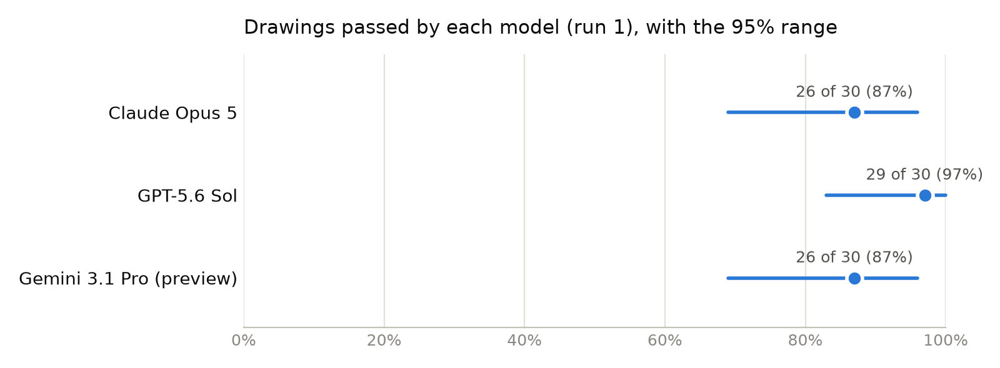
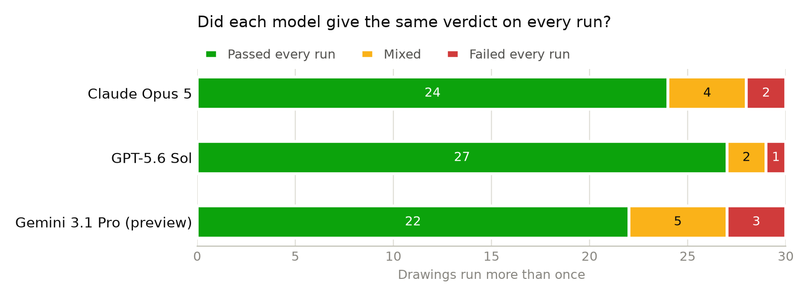
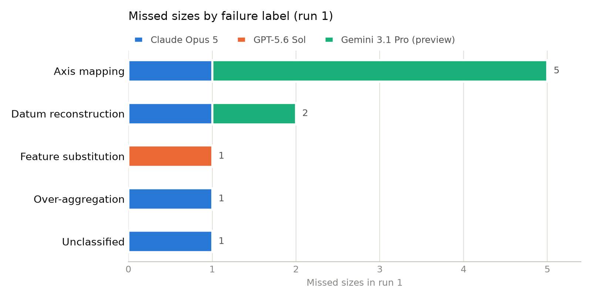

# VLM accuracy when extracting bounding dimensions from 2D engineering drawings

This folder holds the results of one evaluation of vision-language models (VLMs): AI models that read images as well as text. The evaluator (the person who ran this evaluation) sent 30 engineering drawings to 3 VLMs (Claude Opus 5, GPT-5.6 Sol and Gemini 3.1 Pro (preview)) and asked each model for the part's bounding dimensions: the overall size of the stock the part is made from. Code then graded every answer against the sizes the evaluator recorded by hand from each drawing.

## Each model received the drawing as a PDF and the same one-line question

Each model received the drawing's PDF file unchanged and this question, with no system prompt and no other instructions:

> Return bounding dimensions for this part. If the part would be made from round stock, give cylindrical bounding dimensions (Dia, L). If it would be made from rectangular stock, give cuboid bounding dimensions (Thk, W, L).

Each model answered 30 drawings 3 times. Each answer came from a fresh conversation with no memory of earlier answers. The models answered between 2026-09-20 and 2026-09-29, each at its maker's default thinking setting:

| Model | Version | Maker's default thinking setting |
|---|---|---|
| Claude Opus 5 | `claude-opus-5` | adaptive thinking, effort high |
| GPT-5.6 Sol | `gpt-5.6-sol` | reasoning effort medium |
| Gemini 3.1 Pro (preview) | `gemini-3.1-pro-preview` | thinking level high |

Code, not a person or an AI model, decides whether an answer passes. A small AI model (`claude-haiku-4-5-20251001`) copies the numbers out of each free-text reply and never judges them. An answer passes only when every size matches the evaluator's recorded size, read from either the printed millimetre value or the printed inch value. A cuboid part's three sizes may come in any order. [The grading rules](../../docs/scoring-rules.md) give the exact tolerances.

## GPT-5.6 Sol passed 29 of 30 drawings, Claude Opus 5 and Gemini 3.1 Pro (preview) each passed 26 of 30

These counts use each model's first answer (run 1) for each drawing, so each drawing counts once per model.

| Model | Passed (run 1) | Pass rate | 95% range | Sizes right |
|---|---|---|---|---|
| Claude Opus 5 | 26 of 30 | 87% | 69% to 96% | 76 of 80 |
| GPT-5.6 Sol | 29 of 30 | 97% | 83% to 100% | 79 of 80 |
| Gemini 3.1 Pro (preview) | 26 of 30 | 87% | 69% to 96% | 74 of 80 |
| All three models | 81 of 90 | 90% | none | 229 of 240 |

The 95% ranges of all 3 models overlap, so 30 drawings are too few to say which model reads drawings best.

The 95% range is the span of true pass rates that could plausibly produce the count observed (an exact binomial range). A size counts as right when it matches the evaluator's recorded size. A chain counts each of its parts separately: a chain is a size the drawing never prints whole, which the reader must add up from smaller printed dimensions.

Source: [`tables/pass-rate-by-model.csv`](tables/pass-rate-by-model.csv).

## GPT-5.6 Sol gave the same verdict on every run for 93% of the 30 drawings run more than once, Claude Opus 5 for 87% and Gemini 3.1 Pro (preview) for 83%

A drawing counts as consistent when a model passed it on every run or failed it on every run. A mixed drawing passed on some runs and failed on others, so a single answer from that model on that drawing can't be trusted.

| Model | Drawings run more than once | Passed every run | Mixed | Failed every run |
|---|---|---|---|---|
| Claude Opus 5 | 30 | 24 | 4 | 2 |
| GPT-5.6 Sol | 30 | 27 | 2 | 1 |
| Gemini 3.1 Pro (preview) | 30 | 22 | 5 | 3 |

Sources: [`tables/consistency-by-model.csv`](tables/consistency-by-model.csv), and [`tables/runs-passed-per-drawing.csv`](tables/runs-passed-per-drawing.csv) for each drawing.

## Axis mapping caused the most missed sizes in run 1: 5 of 10

The evaluator gave each missed size one label that says why the model missed it. [The diagnosis playbook](../../docs/diagnosis-playbook.md) defines every label.

| Label | Claude Opus 5 | GPT-5.6 Sol | Gemini 3.1 Pro (preview) | Total |
|---|---|---|---|---|
| Axis mapping | 1 | 0 | 4 | 5 |
| Datum reconstruction | 1 | 0 | 1 | 2 |
| Feature substitution | 0 | 1 | 0 | 1 |
| Over-aggregation | 1 | 0 | 0 | 1 |
| Unclassified | 1 | 0 | 0 | 1 |

Sources: [`tables/failures-by-label.csv`](tables/failures-by-label.csv); missed sizes by axis in [`tables/failures-by-axis.csv`](tables/failures-by-axis.csv) and by size name in [`tables/failures-by-dimension.csv`](tables/failures-by-dimension.csv).

## Splits by kind of drawing show counts only for groups under 5 drawings

Each cell gives drawings passed in run 1, the pass rate and its 95% range. A group with fewer than 5 drawings shows only the count, because a rate from so few drawings would mislead. The all-models column has no range, for the reason given under the limits below.

**Where the size comes from** ([`tables/by-dimension-origin.csv`](tables/by-dimension-origin.csv))

| Group | Claude Opus 5 | GPT-5.6 Sol | Gemini 3.1 Pro (preview) | All three models |
|---|---|---|---|---|
| Chain: the reader must add printed dimensions, 4 drawings | 3 of 4 | 4 of 4 | 2 of 4 | 9 of 12 |
| Printed as one dimension, 26 drawings | 23 of 26, 88% (70% to 98%) | 25 of 26, 96% (80% to 100%) | 24 of 26, 92% (75% to 99%) | 72 of 78, 92% |

**Shape of the part** ([`tables/by-shape.csv`](tables/by-shape.csv))

| Group | Claude Opus 5 | GPT-5.6 Sol | Gemini 3.1 Pro (preview) | All three models |
|---|---|---|---|---|
| Cuboid (CUBE), 16 drawings | 15 of 16, 94% (70% to 100%) | 15 of 16, 94% (70% to 100%) | 13 of 16, 81% (54% to 96%) | 43 of 48, 90% |
| Cylinder (CYL), 14 drawings | 11 of 14, 79% (49% to 95%) | 14 of 14, 100% (77% to 100%) | 13 of 14, 93% (66% to 100%) | 38 of 42, 90% |

**Kind of PDF** ([`tables/by-pdf-type.csv`](tables/by-pdf-type.csv))

| Group | Claude Opus 5 | GPT-5.6 Sol | Gemini 3.1 Pro (preview) | All three models |
|---|---|---|---|---|
| Image-only PDF, 9 drawings | 7 of 9, 78% (40% to 97%) | 9 of 9, 100% (66% to 100%) | 8 of 9, 89% (52% to 100%) | 24 of 27, 89% |
| PDF with a text layer, 21 drawings | 19 of 21, 90% (70% to 99%) | 20 of 21, 95% (76% to 100%) | 18 of 21, 86% (64% to 97%) | 57 of 63, 90% |

**Units printed on the drawing** ([`tables/by-print-type.csv`](tables/by-print-type.csv))

| Group | Claude Opus 5 | GPT-5.6 Sol | Gemini 3.1 Pro (preview) | All three models |
|---|---|---|---|---|
| Millimetres and inches, 27 drawings | 24 of 27, 89% (71% to 98%) | 26 of 27, 96% (81% to 100%) | 23 of 27, 85% (66% to 96%) | 73 of 81, 90% |
| Inches only, 3 drawings | 2 of 3 | 3 of 3 | 3 of 3 | 8 of 9 |

## Limits on what these numbers show

- The headline numbers use run 1 only, so each drawing counts once per model. Counting every run would count the drawings that ran more than once several times over, and make the ranges look narrower than the evidence supports. The later runs feed only the consistency numbers.
- The All three models row has no 95% range. All the models answered the same drawings, so their answers are not independent tries, and a range that treated them as independent would be too narrow.
- Only 4 drawings need a chain, so the chain results are counts, not rates.
- Claude, an AI model made by Anthropic, proposed a label for each new kind of failure, including failures by Anthropic's own model. A failure that repeats an earlier one takes the evaluator's earlier label. The evaluator reviewed every label Claude proposed. The evaluator kept Claude's label on 20 of 24 (83%, 95% range 63% to 95%) and changed the rest. Every label published here is the evaluator's. [`tables/label-review.csv`](tables/label-review.csv) holds these counts. That table is the one table built from the evaluator's review record rather than from [`every-run.csv`](every-run.csv).
- Code could not grade 1 of 270 replies, because the small AI model that copies out numbers flagged that reply as unreadable. That reply counts as neither pass nor fail, and [`every-run.csv`](every-run.csv) marks it NOT GRADED.
- No pass in run 1 relied on a model converting a printed number between millimetres and inches, or on a tolerance limit: every passing size matched a printed number.

## What's in this folder

- [`every-run.csv`](every-run.csv): one row per reply: the values returned, the verdict, sizes right, sizes missed, and the evaluator's label and evidence for each missed size
- [`tables/`](tables/): every table this page quotes, as CSV
- [`charts/`](charts/): each chart as a picture, with the numbers it draws beside it as CSV
- [`raw-replies/`](raw-replies/): every model's full reply, word for word
- [`run-settings.json`](run-settings.json): the models, versions, thinking settings, dates and question
- [`LICENSE-NOTICE.md`](LICENSE-NOTICE.md): the license these drawing-derived files fall under
