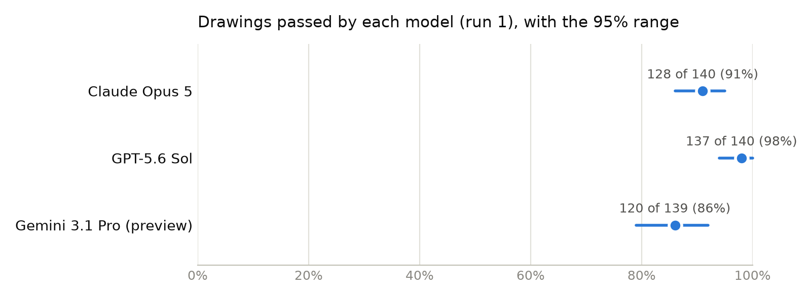
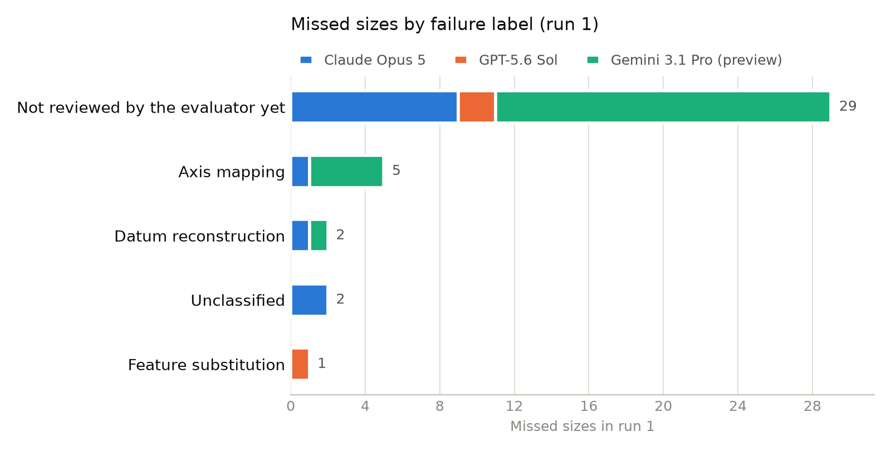

# VLM accuracy when extracting bounding dimensions from 2D engineering drawings

This folder holds the results of one evaluation of vision-language models (VLMs): AI models that read images as well as text. The evaluator (the person who ran this evaluation) sent 141 engineering drawings to 3 VLMs (Claude Opus 5, GPT-5.6 Sol and Gemini 3.1 Pro (preview)) and asked each model for the part's bounding dimensions: the overall size of the stock the part is made from. Code then graded every answer against the sizes the evaluator recorded by hand from each drawing.

## Each model received the drawing as a PDF and the same one-line question

Each model received the drawing's PDF file unchanged and this question, with no system prompt and no other instructions:

> Return bounding dimensions for this part. If the part would be made from round stock, give cylindrical bounding dimensions (Dia, L). If it would be made from rectangular stock, give cuboid bounding dimensions (Thk, W, L).

Each model answered 141 drawings once. Each answer came from a fresh conversation with no memory of earlier answers. The models answered between 2026-09-20 and 2026-10-03, each at its maker's default thinking setting:

| Model | Version | Maker's default thinking setting |
|---|---|---|
| Claude Opus 5 | `claude-opus-5` | adaptive thinking, effort high |
| GPT-5.6 Sol | `gpt-5.6-sol` | reasoning effort medium |
| Gemini 3.1 Pro (preview) | `gemini-3.1-pro-preview` | thinking level high |

Code, not a person or an AI model, decides whether an answer passes. A small AI model (`claude-haiku-4-5-20251001`) copies the numbers out of each free-text reply and never judges them. An answer passes only when every size matches the evaluator's recorded size, read from either the printed millimetre value or the printed inch value. A cuboid part's three sizes may come in any order. [The grading rules](../../docs/scoring-rules.md) give the exact tolerances.

## GPT-5.6 Sol passed 137 of 140 drawings, Claude Opus 5 passed 128 of 140, Gemini 3.1 Pro (preview) passed 120 of 139

These counts use each model's first answer (run 1) for each drawing, so each drawing counts once per model.

| Model | Passed (run 1) | Pass rate | 95% range | Sizes right |
|---|---|---|---|---|
| Claude Opus 5 | 128 of 140 | 91% | 86% to 95% | 349 of 362 |
| GPT-5.6 Sol | 137 of 140 | 98% | 94% to 100% | 359 of 362 |
| Gemini 3.1 Pro (preview) | 120 of 139 | 86% | 79% to 92% | 335 of 359 |
| All three models | 385 of 419 | 92% | none | 1043 of 1083 |

The 95% ranges separate GPT-5.6 Sol from Gemini 3.1 Pro (preview), whose range lies wholly below. The other models' ranges overlap, so 141 drawings are too few to rank them.

The 95% range is the span of true pass rates that could plausibly produce the count observed (an exact binomial range). A size counts as right when it matches the evaluator's recorded size. A chain counts each of its parts separately: a chain is a size the drawing never prints whole, which the reader must add up from smaller printed dimensions.

Source: [`tables/pass-rate-by-model.csv`](tables/pass-rate-by-model.csv).

## Failure labels for run 1 are under review: 29 of 39 missed sizes don't have the evaluator's label yet

The evaluator gave each missed size one label that says why the model missed it. [The diagnosis playbook](../../docs/diagnosis-playbook.md) defines every label. Until the review is finished, the counts below are not a ranking of why the models failed.

| Label | Claude Opus 5 | GPT-5.6 Sol | Gemini 3.1 Pro (preview) | Total |
|---|---|---|---|---|
| Axis mapping | 1 | 0 | 4 | 5 |
| Datum reconstruction | 1 | 0 | 1 | 2 |
| Feature substitution | 0 | 1 | 0 | 1 |
| Not reviewed by the evaluator yet | 9 | 2 | 18 | 29 |
| Unclassified | 2 | 0 | 0 | 2 |

Sources: [`tables/failures-by-label.csv`](tables/failures-by-label.csv); missed sizes by axis in [`tables/failures-by-axis.csv`](tables/failures-by-axis.csv) and by size name in [`tables/failures-by-dimension.csv`](tables/failures-by-dimension.csv).

## Splits by kind of drawing show counts only for groups under 5 drawings

Each cell gives drawings passed in run 1, the pass rate and its 95% range. A group with fewer than 5 drawings shows only the count, because a rate from so few drawings would mislead. The all-models column has no range, for the reason given under the limits below.

**Where the size comes from** ([`tables/by-dimension-origin.csv`](tables/by-dimension-origin.csv))

| Group | Claude Opus 5 | GPT-5.6 Sol | Gemini 3.1 Pro (preview) | All three models |
|---|---|---|---|---|
| Chain: the reader must add printed dimensions, 4 drawings | 3 of 4 | 4 of 4 | 2 of 4 | 9 of 12 |
| Printed as one dimension, 136 drawings | 125 of 136, 92% (86% to 96%) | 133 of 136, 98% (94% to 100%) | 118 of 135, 87% (81% to 92%) | 376 of 407, 92% |

**Shape of the part** ([`tables/by-shape.csv`](tables/by-shape.csv))

| Group | Claude Opus 5 | GPT-5.6 Sol | Gemini 3.1 Pro (preview) | All three models |
|---|---|---|---|---|
| Cuboid (CUBE), 78 drawings | 72 of 78, 92% (84% to 97%) | 76 of 78, 97% (91% to 100%) | 61 of 77, 79% (68% to 88%) | 209 of 233, 90% |
| Cylinder (CYL), 62 drawings | 56 of 62, 90% (80% to 96%) | 61 of 62, 98% (91% to 100%) | 59 of 62, 95% (87% to 99%) | 176 of 186, 95% |

**Kind of PDF** ([`tables/by-pdf-type.csv`](tables/by-pdf-type.csv))

| Group | Claude Opus 5 | GPT-5.6 Sol | Gemini 3.1 Pro (preview) | All three models |
|---|---|---|---|---|
| Image-only PDF, 42 drawings | 37 of 42, 88% (74% to 96%) | 42 of 42, 100% (92% to 100%) | 36 of 42, 86% (71% to 95%) | 115 of 126, 91% |
| PDF with a text layer, 98 drawings | 91 of 98, 93% (86% to 97%) | 95 of 98, 97% (91% to 99%) | 84 of 97, 87% (78% to 93%) | 270 of 293, 92% |

**Units printed on the drawing** ([`tables/by-print-type.csv`](tables/by-print-type.csv))

| Group | Claude Opus 5 | GPT-5.6 Sol | Gemini 3.1 Pro (preview) | All three models |
|---|---|---|---|---|
| Millimetres and inches, 128 drawings | 119 of 128, 93% (87% to 97%) | 126 of 128, 98% (94% to 100%) | 112 of 128, 88% (80% to 93%) | 357 of 384, 93% |
| Inches only, 12 drawings | 9 of 12, 75% (43% to 95%) | 11 of 12, 92% (62% to 100%) | 8 of 11, 73% (39% to 94%) | 28 of 35, 80% |

## Limits on what these numbers show

- The All three models row has no 95% range. All the models answered the same drawings, so their answers are not independent tries, and a range that treated them as independent would be too narrow.
- Only 4 drawings need a chain, so the chain results are counts, not rates.
- Claude, an AI model made by Anthropic, proposed a label for each new kind of failure, including failures by Anthropic's own model. A failure that repeats an earlier one takes the evaluator's earlier label. The evaluator reviews every label Claude proposes, and 29 missed sizes still wait for a label: they read "Not diagnosed yet" or "Not reviewed by the evaluator yet" in the tables. The evaluator kept Claude's label on 7 of 9 (78%, 95% range 40% to 97%) and changed the rest. Every label published here is the evaluator's. [`tables/label-review.csv`](tables/label-review.csv) holds these counts. That table is the one table built from the evaluator's review record rather than from [`every-run.csv`](every-run.csv).
- Code could not grade 4 of 423 replies, because the small AI model that copies out numbers flagged those replies as unreadable. Those replies count as neither pass nor fail, and [`every-run.csv`](every-run.csv) marks them NOT GRADED.
- No pass in run 1 relied on a model converting a printed number between millimetres and inches: every passing size matched a printed number.

## What's in this folder

- [`every-run.csv`](every-run.csv): one row per reply: the values returned, the verdict, sizes right, sizes missed, and the evaluator's label and evidence for each missed size
- [`tables/`](tables/): every table this page quotes, as CSV
- [`charts/`](charts/): each chart as a picture, with the numbers it draws beside it as CSV
- [`raw-replies/`](raw-replies/): every model's full reply, word for word
- [`run-settings.json`](run-settings.json): the models, versions, thinking settings, dates and question
- [`LICENSE-NOTICE.md`](LICENSE-NOTICE.md): the license these drawing-derived files fall under
